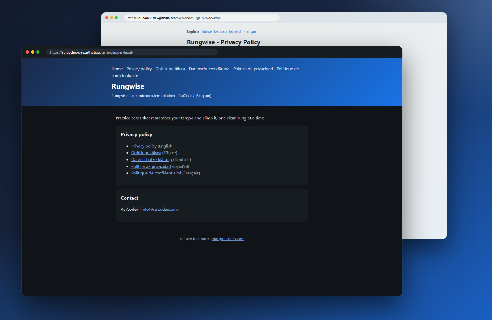
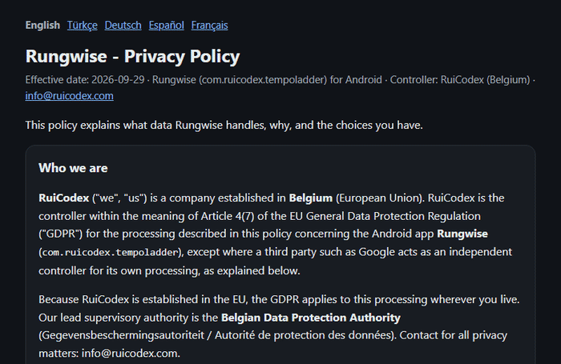
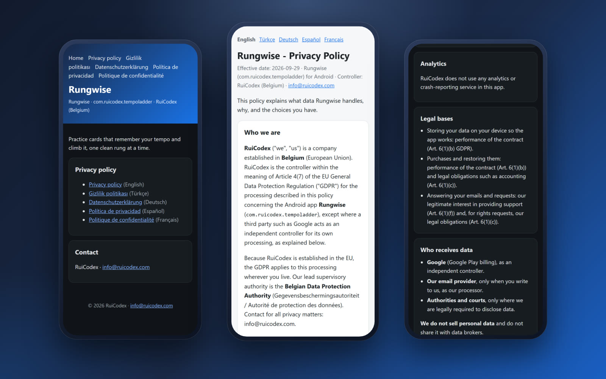
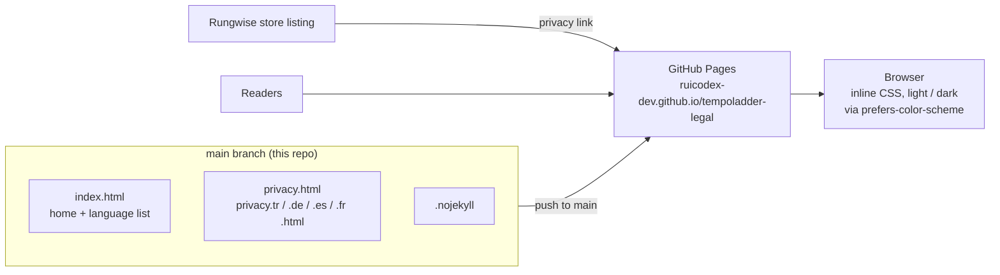

<div align="center">

<a href="https://ruicodex-dev.github.io/tempoladder-legal/">
  <picture>
    
  </picture>
</a>

### The public privacy home of **Rungwise**, the tempo practice app for Android by Rui Codex.


**[Live site](https://ruicodex-dev.github.io/tempoladder-legal/)** &nbsp;·&nbsp;
[Privacy Policy](https://ruicodex-dev.github.io/tempoladder-legal/privacy.html) &nbsp;·&nbsp;
[Türkçe](https://ruicodex-dev.github.io/tempoladder-legal/privacy.tr.html) &nbsp;·&nbsp;
[Deutsch](https://ruicodex-dev.github.io/tempoladder-legal/privacy.de.html) &nbsp;·&nbsp;
[Español](https://ruicodex-dev.github.io/tempoladder-legal/privacy.es.html) &nbsp;·&nbsp;
[Français](https://ruicodex-dev.github.io/tempoladder-legal/privacy.fr.html) &nbsp;·&nbsp;
[ruicodex.com](https://ruicodex.com)

</div>

<br>

<p align="center">
  <a href="https://ruicodex-dev.github.io/tempoladder-legal/">
    
  </a>
  <br>
  <sub>The live site: the home page in dark theme, the Privacy Policy in light theme. Real captures of ruicodex-dev.github.io/tempoladder-legal.</sub>
</p>

## What this is

This repository **is** the website. It is a small, hand-written static site served by GitHub Pages straight from the root of `main`,
and it gives the Android app **Rungwise** (`com.ruicodex.tempoladder`) a stable public URL for its privacy policy, the link its store
listing points to.

Rungwise is a practice app: *practice cards that remember your tempo and climb it, one clean rung at a time.*
The policy describes an app that keeps everything on the device.

<table>
  <tr>
    <td width="33%" valign="top">📱 <b>Stays on your device</b><br>Settings, progress and anything you create live in the app's private storage. No server receives them.</td>
    <td width="33%" valign="top">🙅 <b>No account</b><br>No sign-up, and the app never asks for your name, email address or phone number.</td>
    <td width="33%" valign="top">📊 <b>No analytics</b><br>No analytics or crash-reporting service is used in the app.</td>
  </tr>
  <tr>
    <td width="33%" valign="top">💳 <b>Purchases via Google Play</b><br>Optional purchases run on Google Play Billing; Rui Codex never sees payment details.</td>
    <td width="33%" valign="top">🔔 <b>Local reminders</b><br>Optional reminders are scheduled on the device, not pushed from a server.</td>
    <td width="33%" valign="top">🇪🇺 <b>GDPR first</b><br>Controller established in Belgium, plus KVKK (Türkiye), UK, Swiss and U.S. state rights.</td>
  </tr>
</table>

## The pages

Six HTML files: a home page and the Privacy Policy in five languages.

| Page | What it covers | Link |
|---|---|---|
| **Home** | App name and package, tagline, links to every policy language, contact | [index.html](https://ruicodex-dev.github.io/tempoladder-legal/) |
| **Privacy Policy** (English) | 16 sections: who we are, on-device data, Google Play purchases, notifications, analytics, legal bases, recipients, transfers, retention, rights, security, children, law and disputes, changes, contact | [privacy.html](https://ruicodex-dev.github.io/tempoladder-legal/privacy.html) |
| **Gizlilik Politikası** (Türkçe) | The same 16 sections, with KVKK rights | [privacy.tr.html](https://ruicodex-dev.github.io/tempoladder-legal/privacy.tr.html) |
| **Datenschutzerklärung** (Deutsch) | The same 16 sections | [privacy.de.html](https://ruicodex-dev.github.io/tempoladder-legal/privacy.de.html) |
| **Política de privacidad** (Español) | The same 16 sections | [privacy.es.html](https://ruicodex-dev.github.io/tempoladder-legal/privacy.es.html) |
| **Politique de confidentialité** (Français) | The same 16 sections | [privacy.fr.html](https://ruicodex-dev.github.io/tempoladder-legal/privacy.fr.html) |

<table>
  <tr>
    <td width="58%" valign="middle">
      
    </td>
    <td width="42%" valign="middle">
      <h3>One policy, five languages</h3>
      Every policy page opens with a language bar that links to the other four versions (with <code>hreflang</code> on each link), and the home page lists all five.
      <br><br>
      The translated versions carry a short note: translations are provided for convenience, and if versions differ the English text prevails unless mandatory law says otherwise.
    </td>
  </tr>
</table>

## On a phone

<p align="center">
  
  <br>
  <sub>Home, the policy opening and its middle sections at 390 × 844, in both themes. Real captures of the live site.</sub>
</p>

## How it works



- **Pages are static.** Each file carries its own inline `<style>` with CSS custom properties for a light and a dark palette, switched by `prefers-color-scheme`. There is no JavaScript, nothing to build and nothing fetched from third parties.
- **System fonts only** (`system-ui`, `-apple-system`, `Segoe UI`, `Roboto`), so the pages load fast and send no requests to font hosts.
- **`.nojekyll`** tells GitHub Pages to serve the files exactly as they are.
- The policy pages set `robots: index,follow` so the policy can be found by search engines.

## Tech stack

| Layer | Choice |
|---|---|
| Markup | Hand-written HTML5, one file per page and language |
| Styling | Inline CSS with custom properties, light and dark palettes, a 760 px reading column |
| Script | None |
| Hosting | GitHub Pages, from the root of `main` |
| Fonts and tracking | None loaded: system font stack, no analytics or third-party scripts on the site |

## Getting started

**Prerequisites:** Git and any static file server (Python 3 is enough). There are no dependencies and no environment variables.

```bash
git clone https://github.com/RuiCodex-dev/tempoladder-legal.git
cd tempoladder-legal
python -m http.server 8000
# open http://localhost:8000/
```

**Editing the policy**

1. Change the text in `privacy.html` and make the same change in `privacy.tr.html`, `privacy.de.html`, `privacy.es.html` and `privacy.fr.html`, so all five languages stay in step.
2. Update the effective date at the top of every policy page.
3. Push to `main`. GitHub Pages rebuilds the site within a minute or two; the URLs stay the same, so the store listing link does not need to change.

## Project structure

```text
tempoladder-legal/
├── index.html          # home: app, tagline, links to all five policy languages, contact
├── privacy.html        # Privacy Policy (English)
├── privacy.tr.html     # Gizlilik Politikası (Türkçe)
├── privacy.de.html     # Datenschutzerklärung (Deutsch)
├── privacy.es.html     # Política de privacidad (Español)
├── privacy.fr.html     # Politique de confidentialité (Français)
├── .nojekyll           # serve files as-is on GitHub Pages
└── docs/media/         # README banner, badges and captures (not part of the site)
```

## FAQ

<details>
<summary><b>Does Rungwise send my practice data anywhere?</b></summary>

No. According to the policy, settings, progress, history and anything you enter stay in the app's private storage on your device, and no personal data leaves the device. You can erase it with the app's reset option, with Android Settings &gt; Apps &gt; Rungwise &gt; Storage &gt; Clear storage, or by uninstalling.
</details>

<details>
<summary><b>What happens when I buy something in the app?</b></summary>

Purchases are optional and handled by Google Play Billing, with Google as an independent controller. The app stores only the product identifier and Google Play's purchase confirmation on your device so it can unlock what you bought, and purchases can be restored through Google Play with the same account.
</details>

<details>
<summary><b>Who is the app for?</b></summary>

The policy states that Rungwise is intended for users aged 13 and over and is not directed to children under 13.
</details>

<details>
<summary><b>Which language version applies?</b></summary>

The translated pages say the translations are provided for convenience and that the English text prevails if versions differ, unless mandatory law says otherwise.
</details>

<details>
<summary><b>How do I exercise my privacy rights?</b></summary>

Write to <code>info@ruicodex.com</code> with "Privacy – Rungwise" in the subject. The policy commits to an answer within one month, free of charge. You can also complain to the Belgian Data Protection Authority or the authority where you live.
</details>

## Contact

Rui Codex (Belgium) · `info@ruicodex.com` · [ruicodex.com](https://ruicodex.com)

---

<div align="center">

**License:** All rights reserved, © 2026 Rui Codex.

Built by **[Rui Codex](https://ruicodex.com)**

<sub>Media credits: all screenshots and the language GIF are real captures of the live site; the banner and badges are hand-made SVG. No generated imagery is used.</sub>

</div>
